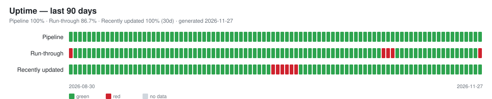

# Uptime

_Last run: **2026-11-28T08:21:28Z**. Auto-generated by `R/uptime.R` (daily GitHub Action). Do not edit by hand._

Three binary daily metrics, one row per day (history in [`data/uptime.csv`](data/uptime.csv)):

- 🟢 **Pipeline** — the daily ETL ran to completion (this is **our** automation; it stays green even when a source is down).
- 🔴 **Run-through (upstream)** — 4 source(s) failed to fetch — **upstream did not deliver** (previous data kept). — **open incident: 2 day(s)**
- 🟢 **Recently updated** — every dataset expected to update is fresh.

| Metric | Uptime 30d | Uptime 90d | Worst incident |
|---|---:|---:|---:|
| Pipeline | 100% | 100% | 1 d |
| Run-through (upstream) | 83.3% | 94.4% | 7 d |
| Recently updated | 100% | 93.3% | 6 d |

## Current run-through

🔴 4 source(s) failed in a way **we must fix** (4xx / parse error) — each opens an `etl-skip` issue:

- `ch_fso_besta` — no master link for PX table px-x-0602000000_101
- `ch_fso_vacancies` — HTTP 400 Bad Request.
- `ch_fso_jobs_sex` — HTTP 400 Bad Request.
- `ch_fso_besta_outlook` — HTTP 400 Bad Request.

## Stale datasets

✅ Nothing stale — see the full board in [STATUS.md](STATUS.md).

## Recent history

| Date | Pipeline | Run-through | Recently updated | Skips | Stale |
|---|---|---|---|---:|---:|
| 2026-11-28 | 🟢 | 🔴 | 🟢 | 4 | 0 |
| 2026-11-27 | 🟢 | 🔴 | 🟢 | 4 | 0 |
| 2026-11-26 | 🟢 | 🟢 | 🟢 | 0 | 0 |
| 2026-11-25 | 🟢 | 🟢 | 🟢 | 0 | 0 |
| 2026-11-24 | 🟢 | 🟢 | 🟢 | 0 | 0 |
| 2026-11-23 | 🟢 | 🟢 | 🟢 | 0 | 0 |
| 2026-11-22 | 🟢 | 🟢 | 🟢 | 0 | 0 |
| 2026-11-21 | 🟢 | 🟢 | 🟢 | 0 | 0 |
| 2026-11-20 | 🟢 | 🟢 | 🟢 | 0 | 0 |
| 2026-11-19 | 🟢 | 🟢 | 🟢 | 0 | 0 |
| 2026-11-18 | 🟢 | 🟢 | 🟢 | 0 | 0 |
| 2026-11-17 | 🟢 | 🟢 | 🟢 | 0 | 0 |
| 2026-11-16 | 🟢 | 🟢 | 🟢 | 0 | 0 |
| 2026-11-15 | 🟢 | 🟢 | 🟢 | 0 | 0 |
| 2026-11-14 | 🟢 | 🟢 | 🟢 | 0 | 0 |
| 2026-11-13 | 🟢 | 🟢 | 🟢 | 0 | 0 |
| 2026-11-12 | 🟢 | 🟢 | 🟢 | 0 | 0 |
| 2026-11-11 | 🟢 | 🟢 | 🟢 | 0 | 0 |
| 2026-11-10 | 🟢 | 🟢 | 🟢 | 0 | 0 |
| 2026-11-09 | 🟢 | 🟢 | 🟢 | 0 | 0 |
| 2026-11-08 | 🟢 | 🔴 | 🟢 | 1 | 0 |
| 2026-11-07 | 🟢 | 🔴 | 🟢 | 1 | 0 |
| 2026-11-06 | 🟢 | 🔴 | 🟢 | 1 | 0 |
| 2026-11-05 | 🟢 | 🟢 | 🟢 | 0 | 0 |
| 2026-11-04 | 🟢 | 🟢 | 🟢 | 0 | 0 |
| 2026-11-03 | 🟢 | 🟢 | 🟢 | 0 | 0 |
| 2026-11-02 | 🟢 | 🟢 | 🟢 | 0 | 0 |
| 2026-11-01 | 🟢 | 🟢 | 🟢 | 0 | 0 |
| 2026-10-31 | 🟢 | 🟢 | 🟢 | 0 | 0 |
| 2026-10-30 | 🟢 | 🟢 | 🟢 | 0 | 0 |
